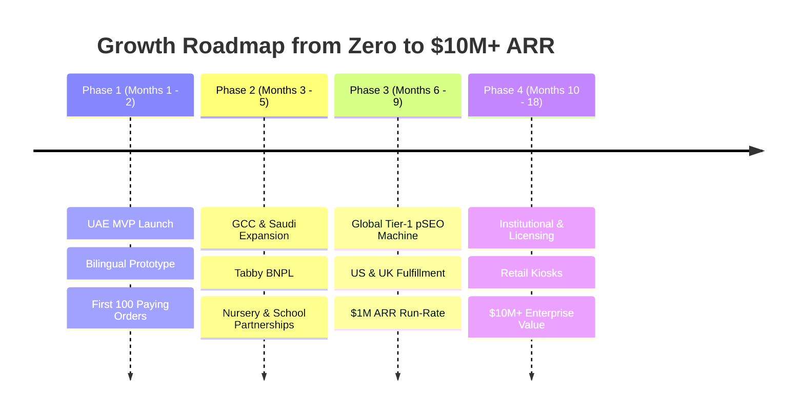

# 06. Strategic Roadmap: From Zero to $1M to $10M+

---

## Phase 1: UAE MVP Launch (Months 1 – 2)
* **Goal:** Launch the platform in UAE, validate product delight, and reach **100 paying customers** with zero inventory.
* **Deliverables:**
  1. Next.js web application with 3D book previewer.
  2. 4 core themes launched: Space Explorer, Desert Falcon, City of Wonder, Dino Adventure.
  3. Integrated Stripe UAE with Apple Pay enabled.
  4. Local printing partner in UAE or Gelato POD connection.
  5. Organic launch across Dubai Mums & Abu Dhabi parenting communities.

---

## Phase 2: GCC Expansion & Gifting Peak (Months 3 – 5)
* **Goal:** Expand into **Saudi Arabia, Qatar, and Kuwait** ahead of Ramadan & Eid.
* **Deliverables:**
  1. Tabby & Tamara Buy-Now-Pay-Later integrations.
  2. Special Ramadan & Eid themed deluxe gift boxes.
  3. Partnerships with 15 UAE/GCC nurseries and private schools (graduation keepsake books).
  4. Targeted influencer gifting campaign with top Arab & expat parenting creators.
  5. Target: **1,000 books/month (~$37,000 USD/mo)**.

---

## Phase 3: Global Tier-1 Programmatic SEO Rollout (Months 6 – 9)
* **Goal:** Capture high-volume organic search traffic from **USA, UK, Canada, Australia, and Western Europe**.
* **Deliverables:**
  1. Launch 10,000+ programmatic SEO pages targeting top names, occasions, and hobbies.
  2. Automated multi-currency checkout (USD, GBP, EUR, AUD, CAD).
  3. Automated POD routing via Gelato / Lulu to 32 printing hubs worldwide for 3-day local delivery in US & UK.
  4. Target: **2,500 books/month (~$100,000 USD/mo -> $1.2M ARR)**.

---

## Phase 4: Omnichannel & Enterprise Scale (Months 10 – 18)
* **Goal:** Build a defensible consumer brand valued at **$10M+ to $50M+**.
* **Deliverables:**
  1. Personalized interactive kiosks in high-end shopping malls (Dubai Mall, Mall of the Emirates, Harrods London).
  2. Brand collaborations & character licensing (e.g., licensed space missions with space agencies, wildlife charities).
  3. B2B Corporate Gifting for multinationals (personalized books as year-end gifts for employees' children).
  4. Target: **15,000+ books/month ($700,000+ USD/mo -> $8.5M+ ARR)**.